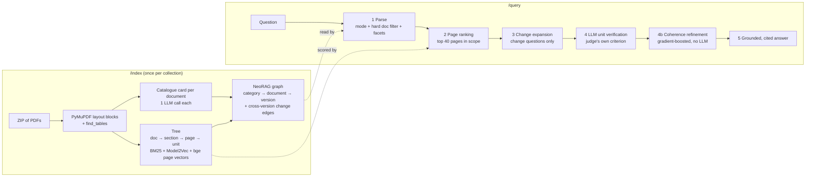
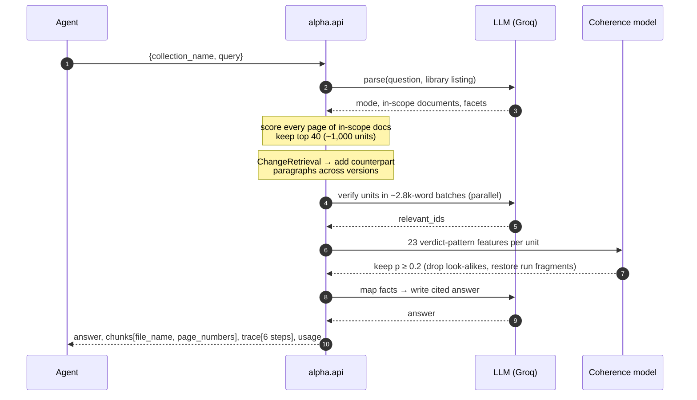
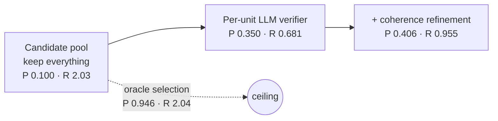
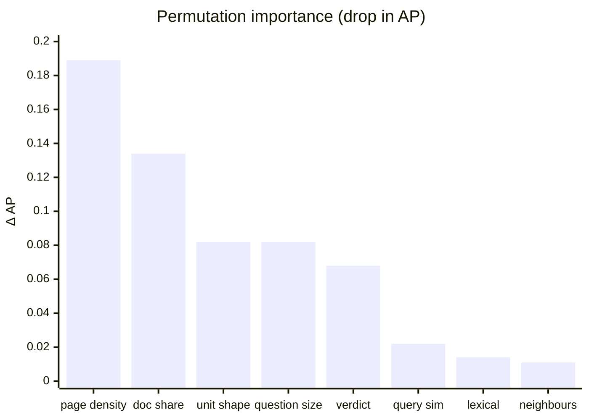
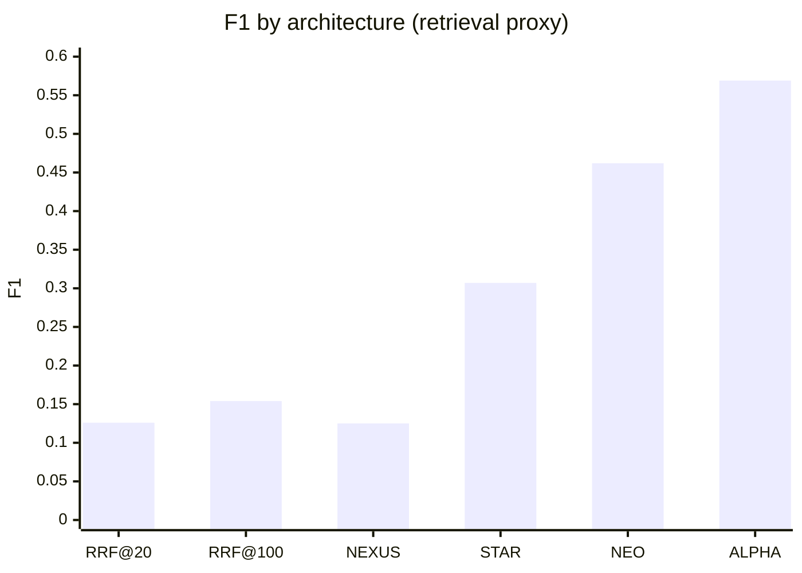
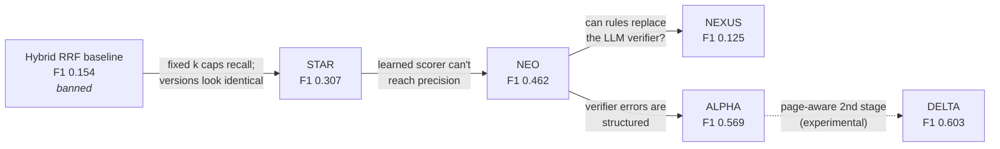

# Smart Knowledge Base for Agents: ALPHA (CognitionNext '26, PS1)

ALPHA is a retrieval and answering engine for large financial and regulatory PDF collections:
capital rules, accounting standards, model papers, and annual reports, often in several versions.
Agents call it over two HTTP routes, `POST /index` and `POST /query`. Each answer is cited, and every
returned chunk names its file and page.

Our main finding: **the bottleneck is selection, not retrieval.** The candidate pool ALPHA retrieves
already holds enough gold for precision 0.95. Most of what is lost happens when deciding which
candidates to keep. ALPHA adds one stage to that decision. A small classifier re-judges every candidate
from the *pattern* of LLM verdicts on its page. It needs no extra LLM calls and adds under 1 s.

| | Proxy P | Proxy R | F1 |
| --- | ---: | ---: | ---: |
| Hybrid BM25 + dense RRF, top-100 (the banned baseline) | 0.111 | 0.253 | 0.154 |
| **ALPHA (shipped, τ = 0.20)** | **0.406** | **0.955** | **0.569** |

That is 3.7× the baseline's F1 and 3.8× its recall, measured out of fold on the training questions
([caveats](#caveats-read-these-before-quoting-numbers)).

---

## Contents

- [How it works](#how-it-works)
  - [Indexing](#indexing-post-index)
  - [Querying](#querying-post-query)
  - [Stage 4b: coherence refinement](#stage-4b-coherence-refinement-the-alpha-contribution)
- [Results](#results)
- [Other architectures we built and researched](#other-architectures-we-built-and-researched)
- [Caveats](#caveats-read-these-before-quoting-numbers)
- [Running it](#running-it)
- [Repository layout](#repository-layout)

---

## How it works



### Indexing (`POST /index`)

Ingestion makes one LLM call per document, for its catalogue card. The rest is CPU work.

| Step | What it does | Why |
| --- | --- | --- |
| **Layout-block units** (`alpha/ingest.py`) | One unit per PyMuPDF text block. Tables become one markdown unit each, prefixed with `Table: <caption>`. Headers and footers are stripped. Blocks over 400 words are split at sentence boundaries. | The benchmark's gold chunks are layout blocks. Raw blocks match gold boundaries at mean Jaccard **0.77**, against 0.54 for merged paragraphs and 0.41 for Docling. Parsing takes ~0.01 s/page; Docling takes ~4 s/page. |
| **Retrieval tree** (`alpha/tree.py`) | Document → Section → Page → Unit. Sections come from the PDF outline. Without an outline, pages are cut with TextTiling where adjacent-page similarity dips. Units get BM25 and Model2Vec vectors. Tables are described by caption, column headers and row labels. | Analysts ask about line items ("borrowings"), not values. Without this, numbers and pipe characters would dominate both BM25 and the vectors. |
| **Page vectors** (`alpha/embed_pages.py`) | One `bge-small-en-v1.5` vector per page. | A stronger page-level signal for ranking. |
| **Catalogue cards** (`engine/catalog.py`) | One LLM card per document: title, issuer, type, jurisdiction, period, version, topics. | The query parser reads these to pick the correct document and version. |
| **NeoRAG graph** (`alpha/graph.py`) | An LLM clusters the cards into categories. A version lattice (shingle containment plus issuer series) groups version families. Paragraphs that exist in only one version are linked to their counterpart in the other version as *change edges*. | Embeddings can't tell FY2024 from FY2025, or a proposal from the final rule. The graph can. |

### Querying (`POST /query`)



| # | Stage (trace `step_name`) | Detail |
| --- | --- | --- |
| 1 | `neorag_query_parse` | One LLM call. It sorts the question into one of three modes: **ContentRetrieval**, **VersionRetrieval** or **ChangeRetrieval**. It returns a **hard** filter of in-scope documents and 2–8 *facets*, the distinct pieces of information a complete answer needs. For change questions, every version in each chosen document's family is added. If no document covers the question, ALPHA abstains. |
| 2 | `tree_page_ranking` | Scores every page in scope. Each page's score combines its best unit score (z-scored dense + 0.5 × BM25), page BM25, and similarity of the page vector to the question plus facets. The top **40** pages are kept. |
| 3 | `change_expansion` | Change questions only. For every change edge that touches a kept unit, the paragraph on the other side of the edge is added. |
| 4 | `unit_verification` | Every unit on those pages goes to the LLM in reading order, in batches of about 2.8k words. The prompt uses the context judge's own wording: *"genuinely relevant and useful for answering the query"*. Text about a different entity, year or version is rejected. |
| 4b | `coherence_refinement` | **The ALPHA stage**, described below. |
| 5 | `llm_answer_generation` | Map-reduce writer that fits within Groq's 8k tokens/minute. Each evidence batch is reduced to atomic cited facts (`[file pN]`). A final call writes the answer from those facts. |

Every response includes a `trace` with one `{step_name, description, input, output}` entry per stage,
plus `usage` (tokens and latency). When Langfuse keys are set, each query is also logged there as `alpha-query`.

### Stage 4b: coherence refinement (the ALPHA contribution)

**Diagnosis.** Run on NEO's candidate pool (93 training questions with saved verifier verdicts), the
numbers look like this:



Retrieval loses almost nothing: the pool already holds enough gold for P 0.95. The verifier judges
each unit in isolation, and that causes two systematic errors:

- **Isolated look-alikes** (precision loss). A unit is accepted on a page where nothing else was
  accepted. Gold doesn't behave like that: annotators mark *runs* of blocks on the same pages.
- **Fragments inside runs** (recall loss). Table rows, headers and list items are rejected even
  though the blocks around them were accepted.

**Method.** Stage 4b is a `HistGradientBoostingClassifier` (300 trees, 15 leaves, ℓ2 = 1). It rescores
every candidate from 23 features:

| Feature group | Examples |
| --- | --- |
| The unit's verdict | was it verified? |
| Page verify density | verified count and share on its page, share of the *other* units on the page |
| Neighbours | verified units within ±1 and ±3 blocks |
| Document share | the document's share of all verified units, and its own verified rate |
| Question-level size | overall verified share, log pool size |
| Query similarity | Model2Vec similarity, its rank, the page's maximum, neighbour mean |
| Lexical overlap | with the question and with the best-matching facet |
| Unit shape | log length, table/heading flag, ends with `:`, digit density |

A unit is kept if *p* ≥ τ = 0.2. Training uses proxy labels with **5-fold question-grouped CV**, so
every number reported here is out of fold. The model is shipped in `alpha/storage/coherence.pkl` and
runs in about 10 ms.

**What it learned: context beats content.** We measured permutation importance as the drop in held-out
average precision when a feature group is shuffled (base AP 0.444, prevalence 9.6%):



Where a unit sits predicts relevance far better than how similar its text is to the question.
Embedding similarity correlates only 0.05 with the gold label, while page density correlates 0.24.
This explains why retrieval based on similarity alone plateaus.

---

## Results

All four architectures, plus the banned baseline, on the training set's retrieval proxy:

| Architecture | Idea | P | R | F1 |
| --- | --- | ---: | ---: | ---: |
| Hybrid RRF top-20 (banned) | fixed chunks, BM25 + dense, RRF | 0.177 | 0.097 | 0.126 |
| Hybrid RRF top-100 (banned) | same, larger k | 0.111 | 0.253 | 0.154 |
| NEXUS (best) | rules in place of every query-time LLM step | 0.080 | 0.281 | 0.125 |
| STAR | calibrated LightGBM unit scorer + evidence graph + set selector | 0.199 | 0.673 | 0.307 |
| NEO | NeoRAG graph routing + page ranking + LLM unit verifier | 0.350 | 0.681 | 0.462 |
| ALPHA, τ = 0.25 | NEO + coherence refinement | 0.427 | 0.819 | 0.561 |
| **ALPHA, τ = 0.20 (shipped)** | NEO + coherence refinement | **0.406** | **0.955** | **0.569** |
| ALPHA + cross-encoder | adds MS-MARCO MiniLM rerank features | 0.425 | 0.768 | 0.547 |
| *Oracle over NEO's pool* | *perfect selection* | *0.946* | *2.040* | *1.293* |



**Threshold sweep** (out of fold). τ trades precision for recall:

| τ | 0.15 | **0.20** | 0.25 | 0.30 |
| --- | ---: | ---: | ---: | ---: |
| P | 0.379 | **0.408** | 0.427 | 0.437 |
| R | 1.136 | **0.963** | 0.819 | 0.695 |

τ = 0.2 gives the best F1 while keeping recall above 0.9. A per-question relative threshold did not
beat a flat τ.

**What each architecture taught us**

- **STAR → NEO.** Precision needs a verifier aligned with the judge. STAR's learned scorer reached recall
  0.67 but stayed at P 0.20. Its gold-count estimate correlated only r = 0.31 with the truth, so it
  over-selected 172–207 units per question.
- **NEXUS.** Rules cannot replace the verifier. Lexical overlap can't tell relevant text from look-alikes.
- **ALPHA.** The verifier's own errors follow a pattern, and page context is enough to learn it.
- **Negative result.** Following Self-Healing-RAG, we tried a cross-encoder rerank as an extra feature.
  It didn't help: a web-search reranker is out of domain for regulatory text. It is off by default
  (`ALPHA_CE=1` turns it on).

**Corpus and operations**

| | |
| --- | --- |
| Training corpus | 35 PDFs, 6,958 pages, 100 questions |
| Gold per question | median ~81 chunks; median chunk 63 words |
| Candidate pool | top 40 pages ≈ 1,000 units ≈ 95k tokens per question |
| Change links found | 101 cross-version paragraph pairs |
| Index one 9-page PDF | 5 s |
| One end-to-end query | ~112 s, almost all of it spent waiting on Groq free-tier rate limits (8k TPM) |
| Coherence stage | ~10 ms, no LLM |

---

## Other architectures we built and researched

In the 12-hour window we built four architectures end to end. Each one was designed to fix the
measured weakness of the one before it.



### STAR: Structure-aware Typed Adaptive Retrieval (`engine/`, `scripts/`)

This was our first design, described in the [STAR technical report](docs/report/star_report.pdf). It
treats retrieval as **set selection**: choose a calibrated set of evidence for each question instead of
a fixed top-k.

- **Typed evidence units.** Paragraphs, tables and OCR text, each typed so the unit roughly matches
  the size and shape of a gold chunk.
- **Catalogue cards.** One LLM card per document (title, issuer, entities, period, version). The whole
  corpus cost $0.025.
- **Version-family lattice.** Links documents that are versions of each other and pairs paragraphs that
  changed between versions (101 change links). It treats near-duplicates as structure, not noise.
- **Run-aware calibrated scorer.** LightGBM with Platt calibration over query-relative features, plus an
  evidence graph (SIGN features, then Correct & Smooth with α = 0.5) that spreads relevance to neighbouring units.
- **Expected-utility set selector.** Picks k per question to maximise expected F1.

**Outcome.** Recall rose to 0.673, 2.7× the baseline, but precision stayed at 0.199. The selector's
gold-count estimate correlated only r = 0.31 with the truth, so STAR over-selected. The graph and
smoothing layers added just +0.03 F1. STAR's catalogue cards, version lattice and writer rules live on
inside ALPHA through `engine/`.

### NEO: NeoRAG graph + LLM verifier (`neo/`)

NEO ports [NeoRAG](https://github.com/Ghruank/neorag)'s category → document → version graph to financial
corpora and drops STAR's learned layers. It is ALPHA without stage 4b: LLM-free layout-block ingestion,
a hard document/version filter, tree page ranking, and an LLM verifier that uses the judge's own wording.

**Outcome.** P 0.350, R 0.681: 1.75× STAR's precision at the same recall. This established that precision
needs a verifier aligned with the judge. The cost is about 1,000 candidate units and ~95k tokens per question.

### NEXUS: deterministic evidence contracts (`nexus/`)

NEXUS tested whether structure alone could replace NEO's expensive LLM steps:

- A deterministic **evidence contract** replaces the LLM parse. It holds the scope, years and facets the
  answer must cover, all derived from the question and the catalogue.
- Per-facet SQLite FTS5 search plus a flat Model2Vec page-vector sidecar replace tree ranking. There is
  no vector database.
- A lexical facet-term scorer replaces the LLM verifier. Only one LLM call remains, to frame the answer,
  and NEXUS returns an extractive cited answer if that call is unavailable.

**Outcome.** P 0.080, R 0.281, worse than STAR. **Lesson:** lexical overlap cannot tell relevant text
from look-alikes, so NEO's precision really does come from the LLM verifier.

### DELTA: page-aware precision stage (experimental, not yet in this repo)

DELTA is a copy of ALPHA with stage 4b replaced. Its target is ALPHA's false positives: 50% are
off-target blocks on gold pages and 32% are on the right document but the wrong page. It adds the page
ranker's score and rank, layout and boilerplate features (block position, how often the text repeats
in the document), and a **stacked second classifier** in the style of Correct & Smooth. That classifier
sees stage-1 scores aggregated over the page, the neighbours and the document, so it can drop a whole
weak page. It also always returns at least 5 units.

**Outcome (nested CV, proxy).** P 0.450, R 0.917, F1 **0.603**, the best of any model: about +0.045
precision over ALPHA at similar recall. Precision plateaus near 0.45–0.5 on the proxy, because half the
remaining "false positives" are on-topic blocks on gold pages that the annotator did not mark.

### Paradigms we researched and rejected

Before the build we surveyed retrieval paradigms that go beyond standard RAG for long financial
documents (`research_notes/`, `reports/`). We ranked these alternatives against the PS1 metrics:

| Alternative | Verdict | Why |
| --- | --- | --- |
| PageIndex-style TOC-tree navigation | Partly adopted | Reports 98.7% on FinanceBench (vendor-reported). Returning whole sections hurts precision because gold covers only ~40–56% of a page. We kept the tree for **page** ranking. |
| ColBERTv2 late interaction | Not adopted | Best retriever on DocFinQA, but it is a scoring function, not an architecture, and needs GPU time we didn't have. |
| Hard-negative bi-encoder fine-tuning on version siblings | Stretch goal | Version siblings give free hard negatives, but there was no evidence of the gain on version confusion. |
| Self-Route / long context per document | Rejected | Documents run 200–1,982 pages, which is costly, and it returns no chunks for the context metrics. |
| RAPTOR cluster-summary tree | Rejected | Needs thousands of summarisation calls, suits thematic questions rather than exact figures, and has no financial results. |
| HippoRAG 2 (OpenIE + PPR) | Rejected | Too close to the banned GraphRAG, and OpenIE over ~8,600 pages is costly. |
| Gap-based adaptive-k cutoff | Fallback only | ~70% recall, and weak on summary-style questions. |
| ColPali page-image retrieval | Rejected | Only ~3 points over OCR + BM25 on financial reports, and needs a GPU. |
| LLMLingua / RECOMP compression | Rejected | Lowers long-form key-point recall, and breaks the rule that returned chunks are the chunks used. |
| Docling / pymupdf4llm parsing | Rejected | Docling matches gold at J 0.41 and runs ~4 s/page. pymupdf4llm is 4× slower than raw blocks for +0.01 J. |
| Self-Healing-RAG cross-encoder rerank | Tried in ALPHA, off | Out of domain for regulatory text; no gain (see Results). |

---

## Caveats (read these before quoting numbers)

- **All numbers above are a text-overlap proxy**: a selected unit counts as relevant when it carries
  gold text. The official context precision is LLM-judged and does not see the gold text, so it is
  more lenient toward relevant non-gold text. The judge also rejects about 24% of the gold chunks
  themselves, which caps both context metrics.
- **Proxy recall overstates coverage.** The proxy counts every selected unit that is at least 50% inside
  a gold chunk, so several small units can count against the same gold chunk. A later audit found that
  ALPHA's proxy R of about 1.0 corresponds to only about **0.24 coverage of distinct gold chunks**.
  NEO's candidate pool covers about 0.37. The real recall bottleneck is page retrieval. Official
  context recall is also **capped at 1 per question**, so proxy values above 1 do not translate into
  official recall.
- **Train/serve skew.** The coherence model was trained on Claude Haiku verdicts but is served with
  Groq verdicts. The verdict patterns differ somewhat.
- **Small benchmark.** With only 100 questions, τ may shift on a new corpus.
- **Cost and latency.** The verifier reads about 1,000 units per question, and that dominates cost and
  latency. The obvious next step is to run the classifier *before* the LLM as a pre-filter, so the
  LLM verifies about 300 units instead of 1,000.

---

## Running it

```bash
python3 -m venv .venv && .venv/bin/pip install -r alpha/requirements.txt
# .env at the repo root: GROQ_API_KEY, GROQ_API_KEY_2 (optional),
#                        LANGFUSE_PUBLIC_KEY, LANGFUSE_SECRET_KEY, LANGFUSE_BASE_URL (optional)
.venv/bin/uvicorn alpha.api:app --host 0.0.0.0 --port 8000
```

Index a collection. The request returns once the collection can be queried; it streams keep-alive
whitespace until then, so proxies don't drop it:

```bash
curl -X POST localhost:8000/index -F collection_name=train -F file=@docs.zip
# {"status":"success","collection_name":"train","documents":35,"pages":...,"units":...,"categories":...,"seconds":...}
```

Query it:

```bash
curl -X POST localhost:8000/query -H 'content-type: application/json' \
  -d '{"collection_name":"train","query":"How did the CET1 ratio change between FY2024 and FY2025?"}'
```

```jsonc
{
  "answer": "… [file.pdf p12] …",
  "chunks": [{"content": "…", "metadata": {"file_name": "file.pdf", "page_numbers": [12], "unit_id": "…"}}],
  "trace": [{"step_name": "neorag_query_parse", "description": "…", "input": "…", "output": {…}}, …],
  "usage": {"tokens": {"prompt": 0, "completion": 0}, "latency_s": 0.0}
}
```

The LLM client (`alpha/llm.py`) rotates through `gpt-oss-120b`, `qwen3.8-27b` and `gpt-oss-20b` on Groq.
Before each request it checks the model's sliding one-minute token window, so long jobs pace
themselves instead of hitting 429 errors. Set `NEO_LLM=opencode` to switch provider.

Reproduce the experiment table and retrain the coherence model:

```bash
.venv/bin/python -m alpha.exp_coherence
.venv/bin/python -m alpha.run outputs/alpha.jsonl A21,B05
```

---

## Repository layout

```
alpha/      the deployed engine: ingest, tree, graph, parser, verify, coherence (exp_coherence.refine), writer, api
engine/     shared STAR index helpers (catalogue cards, version lattice, writer rules); imported, never modified
eval/       harness around the official evaluator, gold-to-unit mapping
neo/        NEO, comparison codebase (ALPHA's base)
nexus/      NEXUS, the LLM-free comparison codebase
scripts/    STAR experiments and the retrieval proxy
docs/       research notes, STAR technical report (docs/report/), team split
```

Only `alpha/` backs the API, together with the `engine/` and `eval/` modules it imports. `neo/`, `nexus/`
and STAR are kept so the comparison table above can be reproduced. More detail on ALPHA alone is in
[`alpha/README.md`](alpha/README.md).
